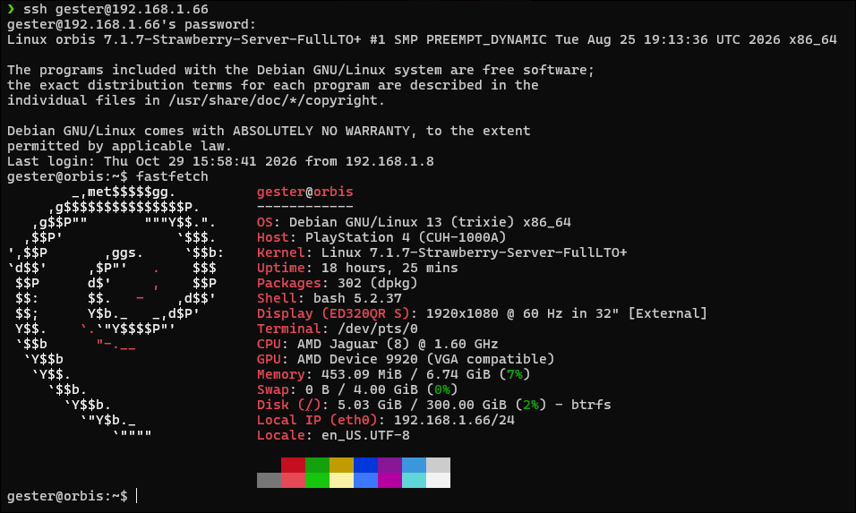

# Debian GNU/Linux minimal install for PS4
Version: Debian DNU/Linux 13 (trixie)



## Default logins
username: ps4linux
password: ps4linux
root password: ps4linux

## Preinstalled packages
build-essential
git
neovim

PS4 SPECIFIC GRAPHICS DRIVERS ARE NOT INSTALLED.
Swap is not pre-configured.

## Certificate error when using apt
If you experience an error validating certificates while using apt,
check that the date and time is set correctly and correct it if not.
```bash
date
sudo date -s "2026-12-31 23:59:00"
```
replace the month day and time with their true values.
